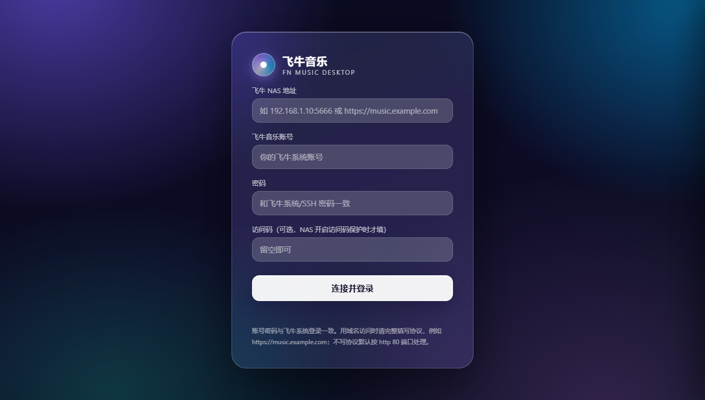
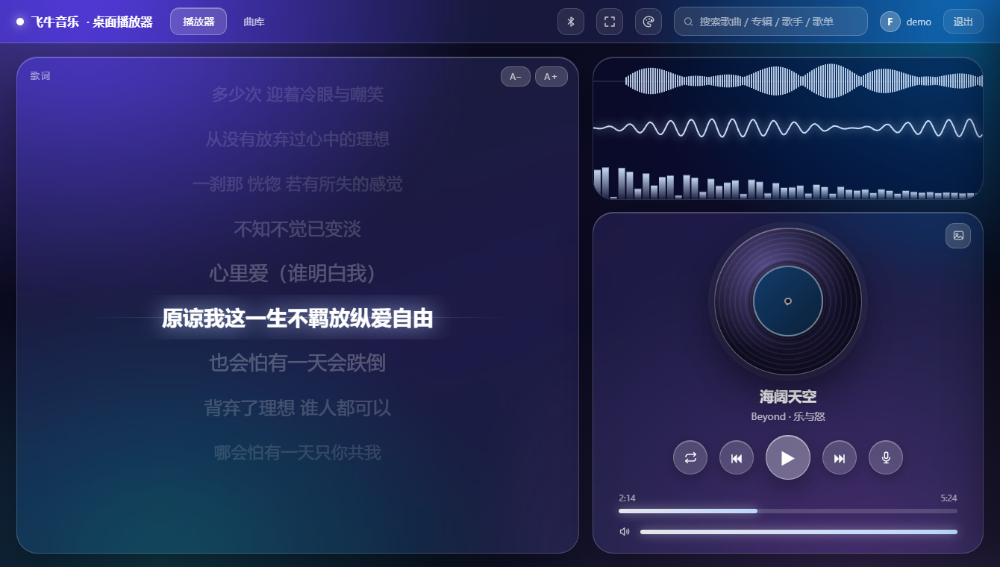
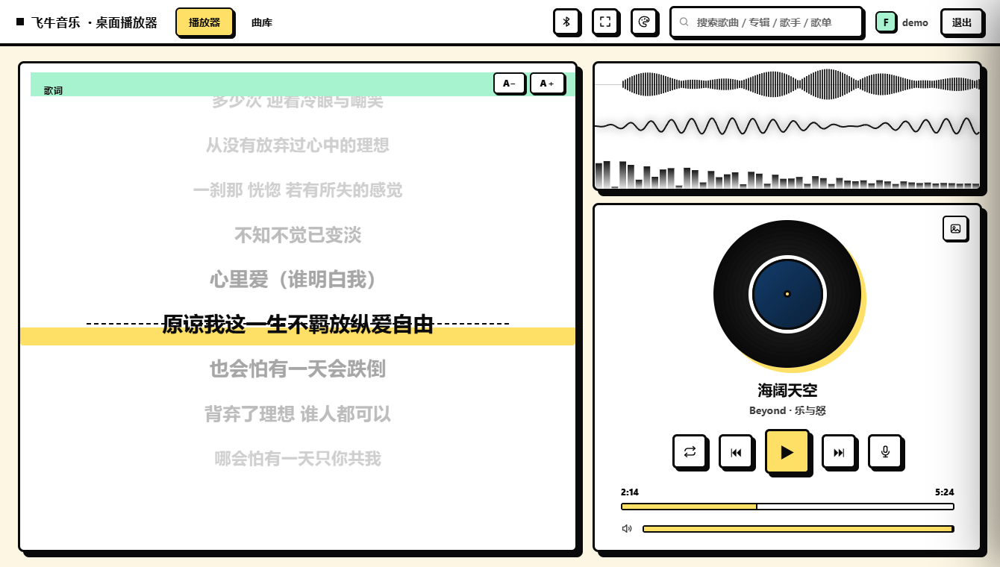
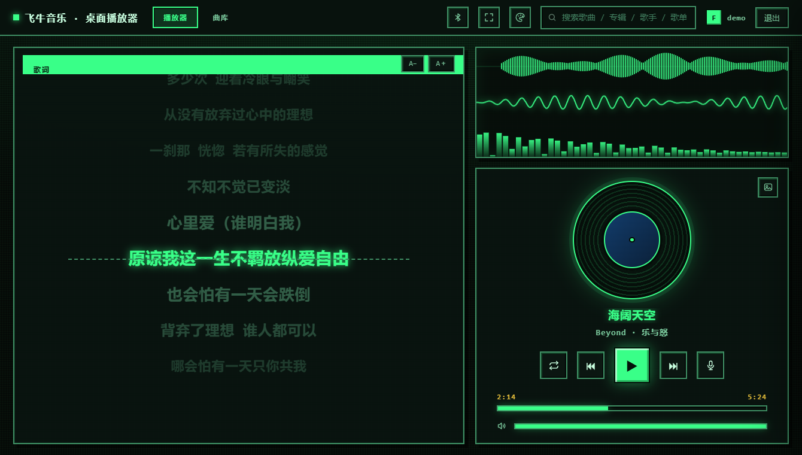

# 咔一下子音乐

桌面音乐播放器（Windows / macOS），基于 Electron。

**两种数据源，开箱选一个就行：**
- **飞牛 NAS** —— 连你自己的飞牛音乐服务，曲库读 NAS 里已有的音乐
- **Docker** —— 连自建曲库容器，**不装飞牛也能用**，同网段自动搜索，不用填账号密码

界面按"提词器"的思路重做过：左边一屏歌词，右边三块实时波形，皮肤可整套切换。

> ⚠️ **本项目为第三方爱好者作品，与飞牛官方无关。**
> 接口分析仅用于学习交流，请勿用于商业用途。项目不内置任何账号、地址或接口密钥，
> 使用者需自行准备。接口随时可能随官方升级而失效。

---

## 功能

**播放**
- 登录飞牛账号，曲库 / 专辑 / 歌手 / 歌单 / 收藏 + 搜索
- 三种循环模式、上一曲下一曲、拖动进度
- 记住密码自动登录、退出后恢复上次播放位置

**界面**
- 歌词逐行同步，字号可调，长按提词器式滚动
- 三条实时波形：10 秒滚动波形 / 时间域波形 / 频谱柱
- 7 套皮肤：透明玻璃、新粗野、8-BIT 像素、新拟物、黏土、瑞士极简、灯箱
- 全屏、置顶、最小化到托盘

**声音**
- 消原声听伴奏（实时处理，不需要下载伴奏）
- 蓝牙音箱显示歌名/封面（Windows 通过系统媒体控制转发，可选）

---

## 截图

| 登录 | 播放（玻璃） |
|---|---|
|  |  |

| 播放（新粗野） | 播放（8-BIT） |
|---|---|
|  |  |

---

## 下载

到 **[Releases](../../releases)** 下载最新版（v2.1.4）：

| 要什么 | 文件 | 说明 |
|---|---|---|
| **服务端**（推荐） | `docker/` 里的 compose | 跑在 NAS 上的 Docker 服务（镜像 `2.1.4`），一条命令部署 |
| Windows 客户端 | `KaYiXiaZi-Music-2.1.4-Setup.exe` | 双击安装，**含签名常量，装完能直接登** |
| 电视客户端 | `KaYiXiaZi-Music-TV-1.3.6.apk` | Android TV / 电视盒子（1.3.7 带拼音搜索，实测后上） |

**服务端起法**：解压 → 把 `env.example` 改名为 `.env` 并填 `MUSIC_DIR` → `docker compose pull` → `docker compose up -d` → 浏览器开 `http://NAS的IP:8580`。详见 [docker/README.md](docker/README.md)。

**客户端不含接口密钥**：

- 连自建 **Docker 服务端** → 装完直接搜局域网，不用配任何东西
- 连**飞牛 NAS** → 需要自己把 `config.local.json` 放到安装目录（和 exe 同级）

> macOS 版暂未提供（v1.5.1 的 dmg 已随旧版一起下架）。

**关于安全提示**

两个包都**没有购买商业代码签名证书**，系统会拦一下，这是正常的：

- **Windows**：SmartScreen 提示"Windows 已保护你的电脑" → 点「更多信息」→「仍要运行」
- **电视**：提示"未知来源" → 允许安装

---

## 使用

1. 安装并打开，登录页顶部先选数据源：**飞牛 NAS** 或 **Docker**
2. 选飞牛：填你的飞牛地址：局域网填 `192.168.1.100:5666`，域名填 `https://music.example.com`（带协议）
3. 填飞牛系统账号密码，点「连接并登录」

macOS 上系统自带「正在播放」，蓝牙音箱会自动显示歌名，不需要额外开关。

---

## 自行构建

需要 Node.js 18+。

```bash
npm install
npm start          # 开发运行
npm run dist       # 打 Windows 安装包（输出到 dist/）
npm run dist:mac   # 打 macOS dmg（需在 macOS 上执行）
```

### ⚠️ 首次运行前必须配置接口密钥

本项目**不包含**飞牛音乐接口的签名常量，缺少它无法连接服务器。

```bash
# 复制模板
cp config.local.example.json config.local.json
```

然后填入你自己的两个值：

```json
{
  "authxPrefix": "你的 authx 前缀",
  "clientKey": "你的 clientKey"
}
```

也可以用环境变量 `FN_AUTHX_PREFIX` / `FN_CLIENT_KEY` 覆盖。

`config.local.json` 已在 `.gitignore` 里，不会被提交。

> 这两个值需要你自己从飞牛音乐 Web 前端的请求里分析得到。
> 项目作者不提供，也不对分析方法的合法性做任何承诺。

---

## 目录结构

```
electron-main.js     Electron 主进程：窗口、全屏、菜单、IPC
preload.js           注入 fnNative / fnBt 两个安全桥
server.cjs           本地服务（127.0.0.1:8530）：静态页 + 飞牛接口代理 + authx 签名
bt-smtc.cjs          蓝牙歌名/封面上屏（Windows 系统媒体控制，可选依赖）
index.html           全部界面（单文件，含样式与逻辑）
config.local.json    接口密钥（本机私有，不入库）
```

为什么要有 `server.cjs`：飞牛接口要求 authx 签名和 `music-token` 会话，
这些放在主进程算，网页侧只认同源地址，密钥和密码不会出现在页面里。

---

## 环境要求

- Windows 10 / 11 x64，或 macOS 11+
- Node.js 18+（仅自建时需要）
- 一个能访问的飞牛 NAS

---

## License

[MIT](LICENSE)
